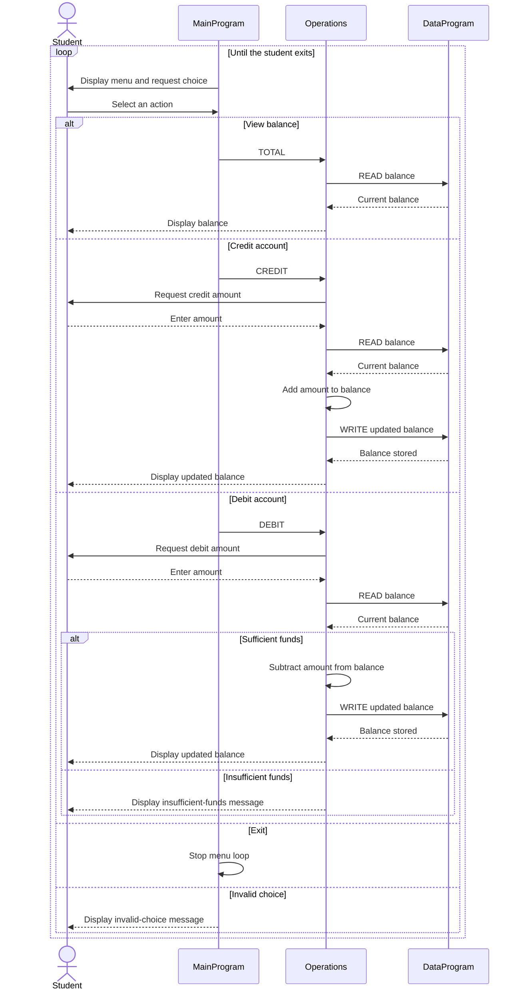

# Student Account COBOL Programs

This directory documents the COBOL programs under `src/cobol/`. Together, they provide a menu-driven interface for viewing and changing an account balance.

## Program Files

### `main.cob` - MainProgram

Runs the interactive account menu and dispatches the user's selection to `Operations`:

- `1` views the balance (`TOTAL ` operation).
- `2` credits the account (`CREDIT` operation).
- `3` debits the account (`DEBIT ` operation).
- `4` exits the program.
- Any other selection displays an invalid-choice message.

### `operations.cob` - Operations

Implements the account actions and prompts for transaction amounts:

- For a balance inquiry, reads and displays the current balance.
- For a credit, reads the balance, adds the entered amount, writes the new balance, and displays it.
- For a debit, reads the balance and subtracts the entered amount only when sufficient funds are available. Otherwise, it displays an insufficient-funds message and leaves the balance unchanged.

### `data.cob` - DataProgram

Provides the balance storage interface. It accepts an operation and balance through its linkage fields. `READ` copies the stored balance to the caller; `WRITE` replaces the stored balance. The stored balance is initialized to `1000.00`.

## Student Account Rules and Limits

- The program starts with one account balance of `1000.00`.
- A debit is allowed only when the current balance is greater than or equal to the requested amount; overdrafts are rejected.
- Credits are added directly to the balance. The program does not check for zero, negative, or otherwise invalid transaction amounts.
- Amounts use `PIC 9(6)V99`, which represents up to six digits before and two digits after an implied decimal point.
- The programs do not store student names, IDs, or multiple accounts. Despite the student-account context, all transactions affect the same balance.
- No transaction history or persistent file/database storage is implemented; the balance is held in the COBOL program's working storage.

## Data Flow

